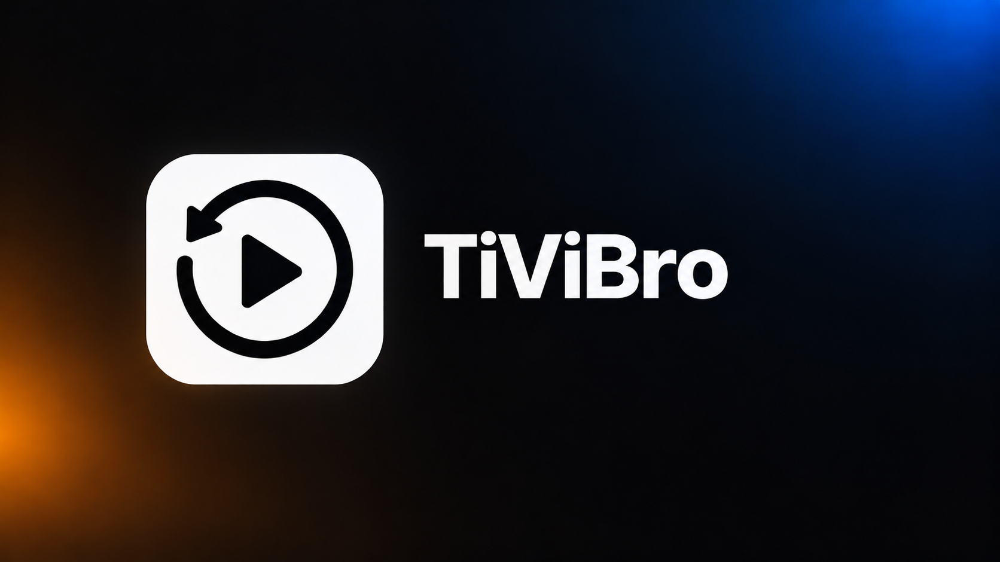
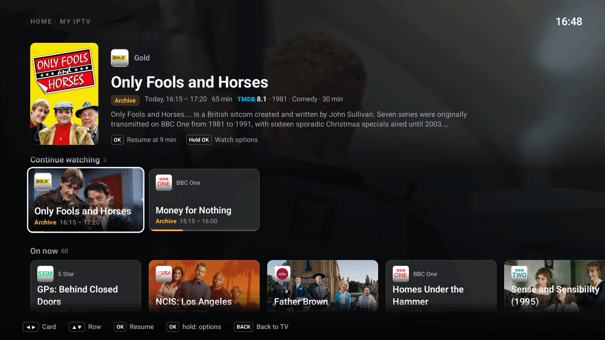
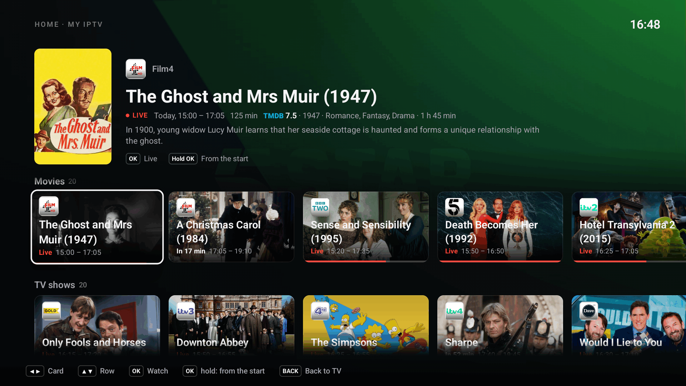
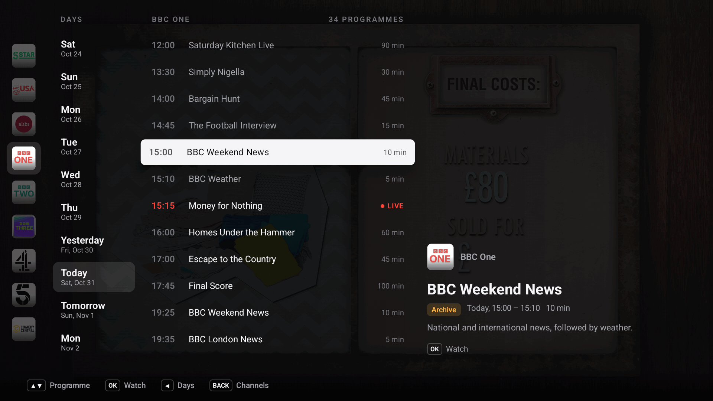
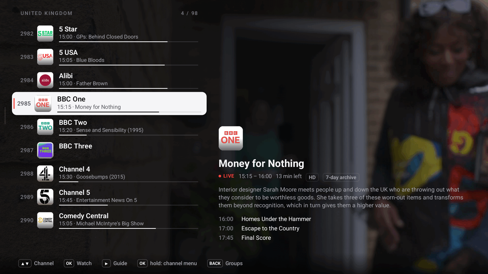
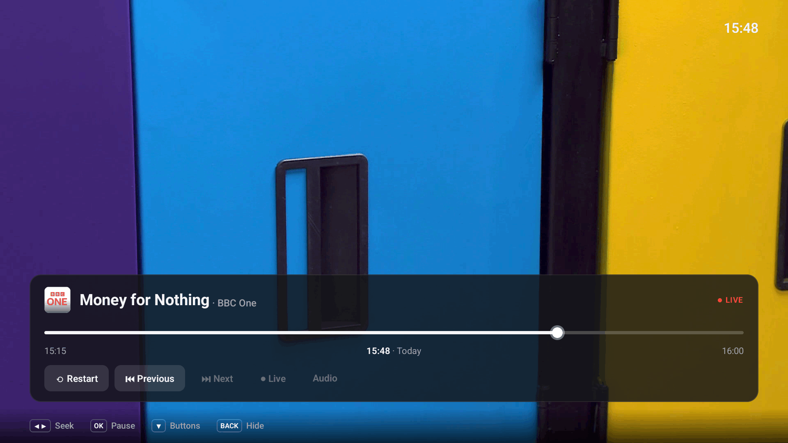

<p align="center"></p>

<p align="center">
  <a href="https://github.com/romirom11/TiViBro/releases/latest"></a>
  <a href="https://github.com/romirom11/TiViBro/releases"></a>
  
  <a href="https://github.com/romirom11/TiViBro/actions/workflows/ci.yml"></a>
  <a href="LICENSE"></a>
  <a href="https://ko-fi.com/romirom11"></a>
</p>

**TiViBro** is a free IPTV player for Android TV. Add the playlist from your IPTV provider and watch live TV, or go
back in time: pause, rewind and play any past programme from the archive, all with the TV remote.

<p align="center"></p>

<table>
  <tr>
    <td width="50%"><br>Films and series on your channels today</td>
    <td width="50%"><br>TV guide: watch any past programme</td>
  </tr>
  <tr>
    <td><br>Channel list with what is on now and next</td>
    <td><br>Pause, rewind, restart or go back to live</td>
  </tr>
</table>

## What it does

- **Watch the archive.** Pause live TV, rewind, start the current programme from the beginning, or pick any past
  programme in the TV guide (if your provider keeps an archive).
- **Continue watching.** Stop in the middle of a programme and pick it up later where you left off.
- **TV guide** for every channel, with days, descriptions and progress.
- **Home page** over the playing video: what you are watching, what to continue, what is on now, what has just
  started, what starts soon, and films and series with posters and ratings. You choose which channel groups it
  looks at in Settings > Home page.
- **Favourites, recent channels and hidden channels.** Hide whole groups you never watch.
- **Several playlists**, each with its own favourites and settings.
- **Search on the TV.** Main menu > Search, or the remote's search key: type with the TV's keyboard (or its mic) and
  results appear as you type, channels by name or number and programmes by title (on now, in the archive, coming up).
- **Your phone as a remote.** Search, browse your groups and a channel's schedule, start things on the TV with a tap,
  manage favourites and hidden channels, continue watching, seek and switch audio. Your AI assistant can do the same
  over MCP.
- **Android TV home screen.** A TiViBro row with what to continue and what is on now (Android 8 and newer).
- **7 languages:** Ukrainian, English, Russian, German, Polish, Spanish and Kazakh.
- **Bigger or smaller text.** Make the whole interface from 90% to 150% of its normal size.
- **Updates itself** when a new version comes out.
- Runs well on older and slower TVs.

## Install

TiViBro works on Android TV and Google TV devices with Android 6.0 or newer.

1. Open the [latest release](https://github.com/romirom11/TiViBro/releases/latest) and download the APK file
   attached to it (there is only one). Two easy ways to get it onto your TV:
   - install the **Downloader** app from the Play Store on your TV and open
     `github.com/romirom11/TiViBro/releases/latest` in it, or
   - download the APK on a computer, copy it to a USB stick and open it with a file manager on the TV.
2. When Android asks, allow that app (Downloader or the file manager) to install unknown apps.
3. Install, then open TiViBro from your apps.

## Add your playlist

You need the link to your M3U playlist. Your IPTV provider gives it to you, usually on your account page.

1. Open TiViBro. It shows a QR code.
2. Scan the QR code with your phone (the phone must be on the same Wi-Fi as the TV).
3. Paste the playlist link into the page that opens and tap **Send**.

The TV loads your channels and starts playing. To add another playlist later, open Settings > Playlists > Add
playlist.

## Remote control

| Key | What it does |
| --- | --- |
| ▲ ▼ or CH+ CH- | Next / previous channel |
| ◀ | Channel list |
| ▶ | TV guide of the channel |
| OK | Player panel: ◀ ▶ rewind and fast-forward, OK pause, ▼ for restart, previous / next programme and back to live |
| Hold OK | Channel menu: add to favourites, hide |
| BACK | Home page. BACK on Home returns to the channel. In the channel list or TV guide, BACK closes it |
| PLAY/PAUSE | Pause, even live TV |
| MENU | Main menu: Home, Search, Settings, Exit |
| SEARCH (if your remote has it) | Search |

In Search, OK on the text field brings up the keyboard, ▼ goes to the results, OK plays (a programme on now plays
live, hold OK to start it from the beginning) and BACK closes it. Channel groups and refreshing the TV guide are in
Settings.

## Phone remote and AI assistant

Open Settings > Phone remote on the TV and scan the QR code with a phone on the same Wi-Fi. The page that opens has
three tabs. Home: Continue watching (tap to resume on the TV where you stopped, × to remove), the channels you watched
last, and what is on your favourites. Search: channels and programmes as you type. Channels: your favourites (with
«Reorder»), your groups, and at the end the hidden groups and channels, to bring back. Every channel has a ☆ that adds
it to or removes it from your favourites on the TV at once; hold a channel to hide it, or a group to hide the group.
Tap a programme for its description and what you can do with it (watch, resume, from the start, live).

The strip at the bottom shows what the TV is playing; tap it for the player: a seek bar you can drag (also back from
live into the archive), steps of 30 seconds and 5 minutes, previous / next programme, from the start, back to live,
channel up / down, and the audio tracks when there are several. If TiViBro is not open on the TV, the page says so.
The link stays the same, so you can bookmark it or add it to your home screen, where it opens like an app. «New link»
in the same place makes a new one and the old link stops working.

The same screen shows an MCP address for AI assistants (it ends in `/mcp`). With Claude Code:

```sh
claude mcp add --transport http tivibro http://<tv-ip>:8765/<token>/mcp
```

Assistants that only run local (stdio) servers can reach it through `npx mcp-remote http://<tv-ip>:8765/<token>/mcp`.
Then ask «what is on 1+1?», «put on yesterday's football», «go back five minutes» or «add Інтер to my favourites». Details in
[docs/DEVELOPMENT.md](docs/DEVELOPMENT.md#phone-remote-and-mcp).

## FAQ

**Where do I get channels?**
From your IPTV provider. TiViBro is only a player: it has no channels of its own and does not sell subscriptions.

**The archive does not work on a channel.**
Your provider has to offer an archive (often called catch-up or timeshift) for that channel. Channels without one can
only be watched live.

**There is no TV guide.**
In Settings > TV guide, keep "Auto" or choose another guide source. You can also send your own guide link from your
phone.

**How do I update?**
TiViBro checks for new versions by itself and tells you when one is ready; the Settings item of the main menu then
shows the new version. Open Settings and choose "Update to X.Y.Z" (or "Check for updates" to look right away). The first time, Android asks you to allow TiViBro to install apps.

**The phone page does not open in Chrome ("This site can't be reached").**
Check that the phone is on the same Wi-Fi as the TV and has no VPN or proxy turned on (Chrome uses Android's proxy
settings, some other browsers do not), and type the address with `http://`. If it still fails, the TV logs every
connection: `adb logcat -s tivibro-http` shows whether Chrome's requests reach it and how they end.

**Is my data sent anywhere?**
No. There are no accounts, no analytics and no tracking. Your playlist, favourites and history stay on the TV. The app
only connects to your provider (channels), your TV guide source, GitHub (to check for updates) and, if posters are
turned on, TMDB: then only the titles of the programmes shown on Home are sent to find posters, never your playlist
or links. You can turn posters off in Settings > Home page.

## Support

TiViBro is free and has no ads. If you enjoy it, you can buy me a coffee on
[Ko-fi](https://ko-fi.com/romirom11). Bug reports and ideas are welcome in
[Issues](https://github.com/romirom11/TiViBro/issues).

<a href="https://ko-fi.com/romirom11"></a>

## More

Building from source and technical details: [docs/DEVELOPMENT.md](docs/DEVELOPMENT.md).

TiViBro is free software under the [GNU General Public License v3.0](LICENSE). Posters and ratings come from
[TMDB](https://www.themoviedb.org); this product uses the TMDB API but is not endorsed or certified by TMDB.
