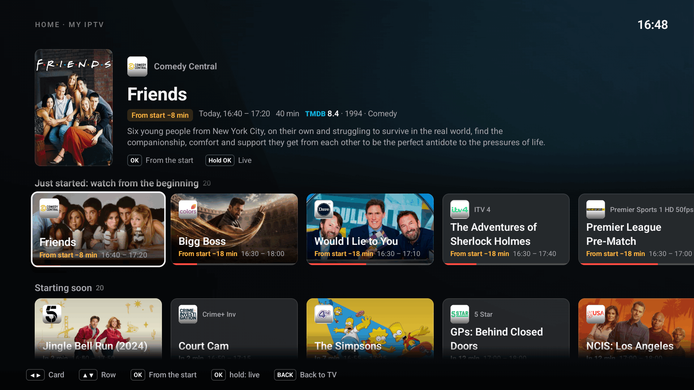
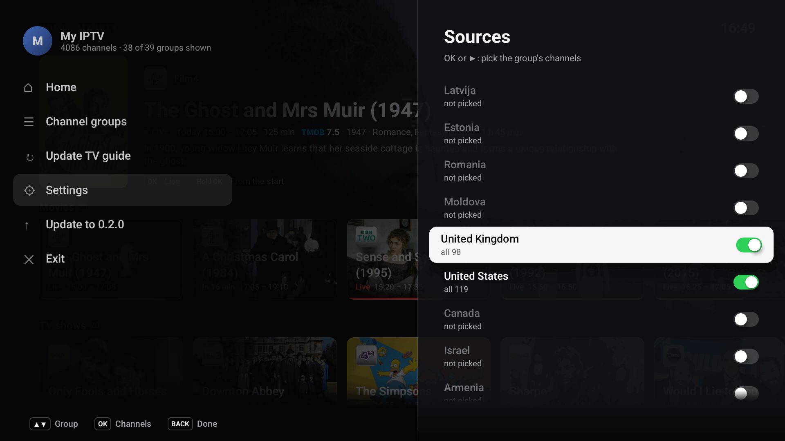
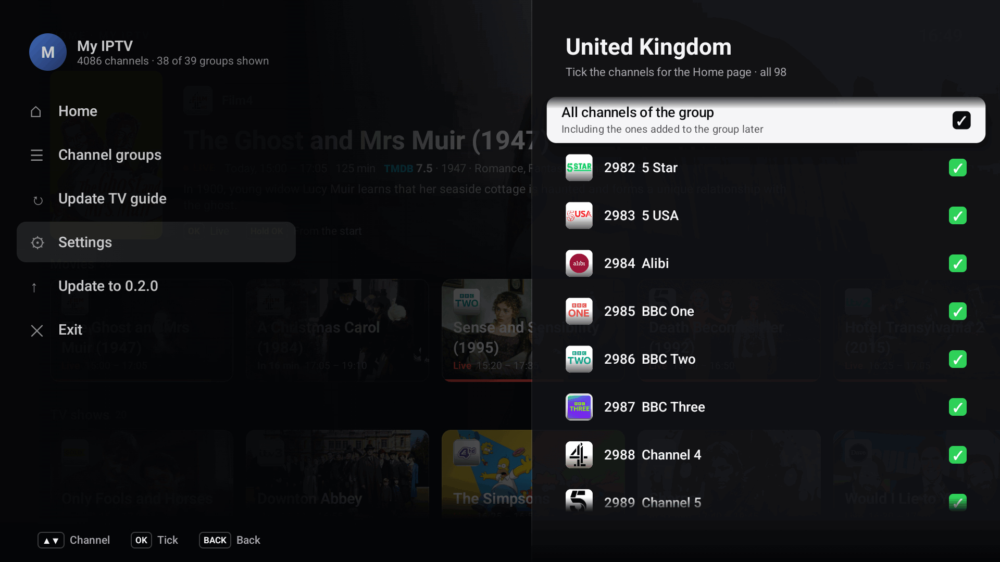
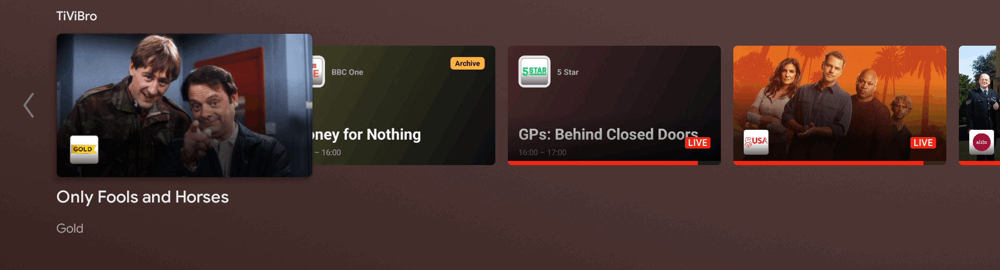
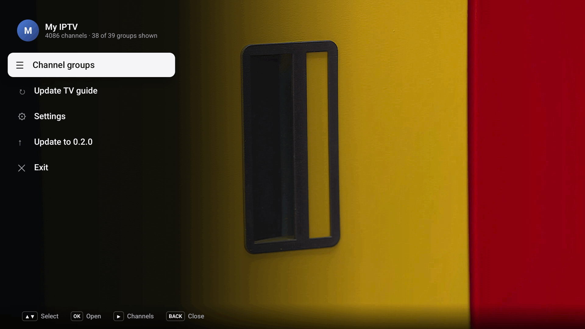
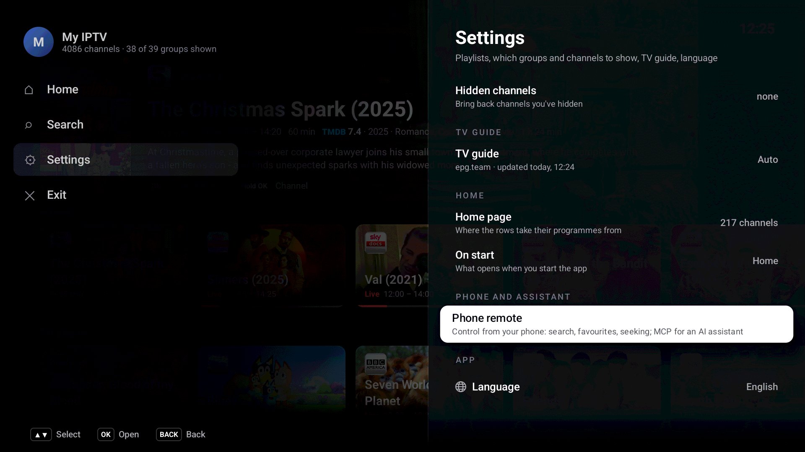
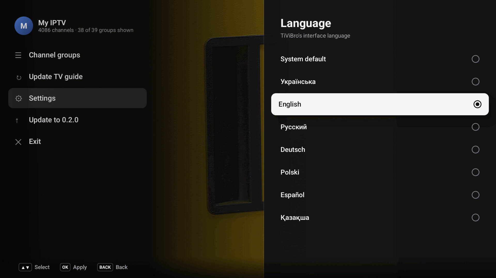

# TiViBro

TiViBro is a remote-first IPTV player for Android TV, built around catch-up. Every channel with an archive can be
paused, rewound and played from the programme guide, and whatever you stop in the middle of shows up again under
"Continue watching". Everything is driven by the D-pad: no touch, no mouse, no on-screen keyboard.

The interface is in seven languages: Ukrainian, English, Russian, German, Polish, Spanish and Kazakh. Pick one in
Settings > Language, or keep "System default", which follows the TV's language and falls
back to English.

## Features

- **Home.** A glass page over the playing video: continue watching, what is on now, what has just started (watch it
  from the beginning), what starts soon, and movies and TV shows with posters, ratings and genres from TMDB. You pick
  which groups or channels feed it. See [Home](#home).
- **On the Android TV home screen.** A «TiViBro» channel with what to continue and what is on now, and unfinished
  archive programmes in Play Next (Android 8 and newer).
- **Catch-up first.** Pause live TV, rewind, jump to the start of the current programme, or open any programme from
  the archive in the guide. Seeking speeds up the longer you hold the key (10 s, 30 s, 1 min, 5 min).
- **Continue watching.** Archive programmes you leave halfway are remembered per playlist. Resume, restart, remove
  them, or mark them as watched.
- **Recent channels.** The last 20 channels you watched, most recent first.
- **Programme view.** Channels, days and programmes side by side, with descriptions, watched marks and progress.
- **Favourites and hidden channels**, show or hide whole provider groups, all per playlist.
- **Several playlists**, each with its own favourites, hidden channels, bookmarks and guide source.
- **Adjustable interface size.** Settings > Interface size makes all text, lists and panels 90%, 100%, 110%, 125% or
  150% of the default, for every playlist at once. The video stays full screen.
- **Setup from your phone.** Scan a QR code and paste the playlist link on your phone instead of typing it with the
  remote. The same page is used for a custom guide link and for renaming a playlist.
- **Light on old TVs.** A small playback buffer, a guide that downloads in the background at low priority and pauses
  while you use the remote, and an FFmpeg audio decoder for MP2 streams that many TVs can't play.
- **Updates itself** from GitHub Releases (see [Auto-update](#auto-update)).

## Screenshots

<table>
  <tr>
    <td width="50%"><a href="docs/screenshots/home.png"></a><br>Home over the playing video: continue watching, on now</td>
    <td width="50%"><a href="docs/screenshots/home-just-started.png"></a><br>Just started: OK plays it from the beginning</td>
  </tr>
  <tr>
    <td><a href="docs/screenshots/home-movies.png"></a><br>Movies and TV shows on your channels, with TMDB posters and ratings</td>
    <td><a href="docs/screenshots/home-sources.png"></a><br>Home sources: the groups Home takes its programmes from</td>
  </tr>
  <tr>
    <td><a href="docs/screenshots/home-source-channels.png"></a><br>Or single channels of a group</td>
    <td><a href="docs/screenshots/android-tv-home.png"></a><br>The TiViBro channel on the Android TV home screen</td>
  </tr>
  <tr>
    <td width="50%"><a href="docs/screenshots/channel-list.png"></a><br>Channel list of a group, with what is on now and next</td>
    <td width="50%"><a href="docs/screenshots/programme-view.png"></a><br>Programme view: days, programmes and an archive programme ready to watch</td>
  </tr>
  <tr>
    <td><a href="docs/screenshots/player.png"></a><br>Player panel: timeline, restart, previous and next programme, back to live</td>
    <td><a href="docs/screenshots/main-menu.png"></a><br>Main menu, with Home first; BACK here opens Home</td>
  </tr>
  <tr>
    <td><a href="docs/screenshots/settings.png"></a><br>Settings, with interface size and language</td>
    <td><a href="docs/screenshots/language.png"></a><br>Language picker: each language in its own name</td>
  </tr>
</table>

## Install

1. Download the latest `TiViBro-vX.Y.Z.apk` from the [Releases](https://github.com/romirom11/TiViBro/releases) page.
2. Sideload it on your Android TV (Android 6.0 or newer). Two common ways:
   - Copy the APK to a USB stick or cloud drive and open it with a file manager on the TV. Allow the file manager to
     install unknown apps when Android asks.
   - Or, with developer options and network debugging enabled on the TV: `adb connect <tv-ip>:5555`, then
     `adb install TiViBro-vX.Y.Z.apk`.
3. Open TiViBro from the launcher's app row.

## First run

TiViBro shows a QR code. Scan it with a phone on the same Wi-Fi network, paste your M3U playlist link into the page
that opens, and tap Send. The TV downloads the playlist and starts the first channel.

The page lives at a random address that changes every time it is shown, so only someone who can see the TV screen can
use it. It runs only while a QR code is on screen.

## Playlists and catch-up

TiViBro reads M3U / M3U8 playlists the way IPTV providers actually write them:

- `#EXTINF` with or without a space before the attributes, durations of `0` or `-1`;
- groups from `group-title` or `#EXTGRP`; entries without a group go to "Other";
- archive depth from `catchup-days`, `timeshift` or `tvg-rec` on the channel, or from `catchup-days` /
  `catchup-time` in the `#EXTM3U` header;
- guide ids from `tvg-id` (including `tvg_NNN` style ids), the `/chNNN/` part of the stream URL, `tvg-name`, or the
  channel name;
- `url-tvg` / `x-tvg-url` in the header as the playlist's guide.

Catch-up URLs are built from `catchup-type` (per channel or in the header), or guessed from the stream URL:

| Scheme | How it is chosen | Archive URL |
| --- | --- | --- |
| Flussonic (HLS and MPEG-TS) | `catchup-type="flussonic"` (also `flussonic-hls`, `flussonic-ts`, `fs`), or a URL ending in `mono.m3u8`, `index.m3u8`, `video.m3u8` and similar | `.../mono-<start>-<duration>.m3u8`, `.../timeshift_abs-<start>.ts` |
| Shift | `catchup-type="shift"` or `timeshift`, or the default for a channel with an archive | `<live url>?utc=<start>&lutc=<now>` |
| Xtream Codes | `catchup-type="xc"`, or a `/live/<user>/<pass>/<id>` URL | `/timeshift/<user>/<pass>/<minutes>/<Y-m-d:H-M>/<id>.ts` |
| Template | any `catchup-source`, with `catchup-type` `default` or `append` | the template with `{utc}`, `{start}`, `{end}`, `{utcend}`, `{lutc}`, `{now}`, `{duration}`, `{duration:60}`, `{offset}`, `{Y}` `{m}` `{d}` `{H}` `{M}` `{S}`, `{(b)...}` and `{(e)...}` filled in |

The token in the live URL's query string is kept on every built-in scheme. When the server answers an archive request
with its "no archive" stub, TiViBro says so and goes back to live instead of playing the stub.

## TV guide

Each playlist picks its guide in Settings > TV guide:

- **Auto** (default): the playlist's own XMLTV link if it has one, otherwise the segmented guide from
  [epg.team](https://epg.team), which arrives day by day, today first.
- **From playlist:** the XMLTV file named by `url-tvg` / `x-tvg-url`.
- **Custom link:** any XMLTV file (`.xml` or `.xml.gz`), sent from your phone through the QR page.

XMLTV files are imported again every 12 hours; the segmented guide is checked every 3 hours and just after midnight.
Downloads are throttled and pause while you use the remote or while the stream is buffering.

## Home

Home is a layer over the video, which keeps playing behind it. Open it from the main menu ("Home", the first item), or
press BACK in the main menu. Its rows, top to bottom (a row with nothing in it is left out):

- **Continue watching**: archive programmes you stopped in, on any channel of the playlist, newest first, while they are
  still in the archive.
- **On now**: what is on the Home sources now.
- **Just started: watch from the beginning**: programmes that started in the last 20 minutes on channels with an
  archive, at least 20 minutes long. Ads, teleshopping, breaks and test cards are left out, and the same title shows
  once.
- **Starting soon**: what starts in the next 30 minutes.
- **Movies** and **TV shows**: programmes on now or later today that TMDB recognises, with poster, rating, year and
  genres; what is on now or within the hour first, then by rating.

**Sources.** Home reads the guide only of the channels you pick: Settings > Home page > Sources lists the playlist's
groups with how much of each is picked ("all 98", "5 of 87"). OK or ▶ on a group opens its channels, with tick boxes
and "All channels of the group" (which also takes channels the provider adds to the group later). Sources are kept per
playlist. Until you pick some, Home shows only Continue watching and a "Choose sources" button. Home reads at most 300
source channels, in the background, a chunk at a time; rows fill in while Home is open.

**Cards.** The focused card is the lit one, and its details are above the rows: the full title, channel, time, TMDB
rating, year and genres, a short description, and what OK does. OK plays a live programme live, a past one from the
archive (resuming where you stopped), and «Just started» from the beginning; on a programme still to come it says when
it starts. Hold OK for the watch options of a bookmark, to start a live programme from the beginning, or the channel
menu.

**On start.** Settings > On start chooses between the last channel (the default) and Home. A playlist that has no last
channel yet (its first start) opens on Home.

**TMDB.** Movies, TV shows and pictures need a TMDB key. Release builds come with one; otherwise, or to use your own,
Settings > Home page > Your own TMDB key takes an API Read Access Token from
[themoviedb.org](https://www.themoviedb.org/settings/api), typed on your phone through the QR page ("-" goes back to
the built-in key). "Posters and descriptions from TMDB" turns it all off. Matching is strict: a programme gets a
picture only when its title, kind (film or series, from «х/ф», «т/с», episode numbers) and year agree with TMDB, since
a wrong poster is worse than none.

### On the Android TV home screen

On Android 8 and newer, TiViBro adds a «TiViBro» channel to the launcher with up to 12 programmes: what to continue
first, then what is on now on the Home sources. Unfinished archive programmes also go to Play Next (Watch Next) with
their progress; finished ones and those that left the archive are removed. Opening one starts it in TiViBro: a live
programme live, an archive programme where you stopped (or live, with a note, when it has left the archive). The row is
updated when your bookmarks change, when you leave the app and every 45 minutes, from what the app saved; only
titles, times and pictures are shared with the launcher, never stream links.

The links it uses can also be opened by other apps: `tivibro://home`, `tivibro://live/{playlist}/{channel}` and
`tivibro://archive/{playlist}/{channel}/{start ms}?position={ms}`.

## Remote control

BACK always goes one level up, in the same order everywhere:

```
playback  >  programme view  >  channel list  >  groups  >  main menu  >  Home  >  playback
```

Sheets and dialogs close back to the level they were opened from. BACK on the player panel only hides the panel.
"Exit" in the main menu closes the app.

### Home

| Key | Action |
| --- | --- |
| ◀ ▶ | Previous / next card (◀ on the first card opens the main menu) |
| ▲ ▼ | Previous / next row; each row remembers its card. CH+ / CH- jump to the first / last row |
| OK | Watch, resume, or from the beginning (Just started); a programme still to come says when it starts |
| Hold OK | Watch options of a bookmark; from the beginning of a live programme; channel menu of one to come |
| RED | Favourite |
| MENU | Main menu |
| BACK | Back to playback |

### Plain playback

| Key | Action |
| --- | --- |
| ▲ / CH+, ▼ / CH- | Next / previous channel |
| ◀ | Channel list |
| ▶, GREEN, BACK | Programme view of the current channel, on the programme being played |
| OK | Player panel |
| Hold OK | Channel menu (favourite, hide) |
| 0-9 | Channel by number |
| PLAY/PAUSE | Pause (live TV is paused into the archive) |
| RED | Add to or remove from favourites |
| YELLOW / LAST CHANNEL | Recent channels, on the one you watched before |
| INFO | Show or hide the channel banner |
| MENU | Main menu |

### Player panel

| Key | Action |
| --- | --- |
| ◀ ▶ | Seek back / forward, faster while held |
| OK | Pause / play |
| ▼ | Buttons: Restart, Previous, Next, Live, Audio |
| ▲ | Back to the timeline from the buttons |
| CH+ / CH- | Switch channel |
| BACK | Hide the panel |

### Channel list

| Key | Action |
| --- | --- |
| ▲ ▼ | Move; CH+ / CH- page by 9 |
| OK | Watch (on a Continue watching item: resume) |
| Hold OK | Channel menu; on a Continue watching item: From the start, Remove from Continue watching, Mark as watched |
| ▶ | Programme view of the channel |
| RED | Favourite |
| ◀, BACK | Groups |

In the groups rail, ▲ ▼ choose a group, ▶ or OK go back to the channels, and ◀ or BACK open the main menu.

### Programme view

| Key | Action |
| --- | --- |
| ▲ ▼ | Previous / next programme |
| CH+ / CH-, YELLOW / BLUE | Same time on the previous / next day |
| ◀ | Days column (▲ ▼ day, ▶ or OK back to the programmes) |
| OK | Watch: live for the programme on air, the archive for past ones, resume where you stopped |
| Hold OK | On air: from the start. Watched archive programme: watch options |
| BACK | Channel list |

## Building from source

Requirements: JDK 17 and the Android SDK (API 35). Point `local.properties` at the SDK (`sdk.dir=...`) or set
`ANDROID_HOME`.

```sh
./gradlew assembleDebug        # app/build/outputs/apk/debug/app-debug.apk
./gradlew testDebugUnitTest    # unit tests
./gradlew assembleRelease      # minified release build
```

The TMDB key built into the APK (see [Home](#home)) is read from the Gradle property `tmdbToken`, else the
`TIVIBRO_TMDB_TOKEN` environment variable, else the file `~/.config/tivibro/tmdb_token`; without any of them the build
has no key and users can add their own. It is a TMDB API Read Access Token (v4). Keep it out of the repository.

A debug build accepts a playlist from adb, which is handy on an emulator:

```sh
adb shell am start -n dev.romirom.tivibro/.MainActivity --es playlist 'https://example.com/playlist.m3u'
```

### Versions and signing

`versionName` and `versionCode` come from the release tag: `vX.Y.Z` gives version name `X.Y.Z` and version code
`X*10000 + Y*100 + Z` (v1.4.2 is 10402). Pass it as `-PtivibroVersion=X.Y.Z` or the `TIVIBRO_VERSION` environment
variable; without it a local build is version `0.1` (code 1).

The release build is signed with the first of these that exists:

1. `~/.config/tivibro/keystore.properties` with `storeFile`, `storePassword`, `keyAlias` and `keyPassword`;
2. the environment variables `TIVIBRO_KEYSTORE_BASE64`, `TIVIBRO_KEYSTORE_PASSWORD`, `TIVIBRO_KEY_ALIAS` and
   `TIVIBRO_KEY_PASSWORD` (used by CI);
3. the debug key, so that anyone can build a release APK without the real one.

Never commit the keystore or its passwords; `.gitignore` already keeps `*.jks`, `*.keystore` and
`keystore.properties` out.

## Releasing

### One-time setup

Add the repository secrets under Settings > Secrets and variables > Actions on GitHub, taken from
`~/.config/tivibro/` on the machine that holds the release key:

| Secret | Value |
| --- | --- |
| `TIVIBRO_KEYSTORE_BASE64` | the contents of `release.jks.base64` |
| `TIVIBRO_KEYSTORE_PASSWORD` | `storePassword` from `keystore.properties` |
| `TIVIBRO_KEY_ALIAS` | `keyAlias` from `keystore.properties` |
| `TIVIBRO_KEY_PASSWORD` | `keyPassword` from `keystore.properties` |
| `TIVIBRO_TMDB_TOKEN` | optional: the TMDB API Read Access Token built into releases |

With the GitHub CLI, from the repository directory:

```sh
cd ~/.config/tivibro
gh secret set TIVIBRO_KEYSTORE_BASE64 -R romirom11/TiViBro < release.jks.base64
gh secret set TIVIBRO_KEYSTORE_PASSWORD -R romirom11/TiViBro --body "$(sed -n 's/^storePassword=//p' keystore.properties)"
gh secret set TIVIBRO_KEY_ALIAS -R romirom11/TiViBro --body "$(sed -n 's/^keyAlias=//p' keystore.properties)"
gh secret set TIVIBRO_KEY_PASSWORD -R romirom11/TiViBro --body "$(sed -n 's/^keyPassword=//p' keystore.properties)"
gh secret set TIVIBRO_TMDB_TOKEN -R romirom11/TiViBro < tmdb_token
```

Keep a backup of `~/.config/tivibro/` somewhere safe. Android only accepts an update signed with the same key, so if
the key is lost, every user has to uninstall and install again.

### Publishing a release

```sh
git tag v1.2.3
git push origin v1.2.3
```

The `Release` workflow (`.github/workflows/release.yml`) then:

1. checks that the tag is `vX.Y.Z` and that the signing secrets are present;
2. runs the unit tests and builds the signed release APK with version `X.Y.Z`;
3. publishes a GitHub Release for the tag with `TiViBro-vX.Y.Z.apk` attached and release notes generated from the
   commits since the previous release.

Building and publishing are separate jobs: the build job sees the signing secrets but can only read the repository,
and the publish job can create releases but never sees the secrets. Every action is pinned to a commit SHA, and
Dependabot (`.github/dependabot.yml`) proposes updates to those pins weekly.

Installed copies find the new release on their next check (see below) and offer to update. The `CI` workflow builds
and tests every other push and every pull request.

## Auto-update

On start, and at most once every 12 hours, TiViBro asks the GitHub API for the latest release of
`romirom11/TiViBro` (no account or token involved). If its tag is newer than the installed version and it has an APK
attached:

- a short message says "Update available: X.Y.Z";
- the main menu gets an "Update to X.Y.Z" item;
- Settings > Check for updates checks right away, or installs the update when one is waiting.

Choosing the update downloads the APK to the app's cache, showing progress, and hands it to Android's package
installer, which asks you to confirm. On Android 8 and newer, the first time, Android has to allow TiViBro to install
apps: TiViBro opens that settings screen for you; switch it on, go back and choose the update again.

Being offline, hitting GitHub's rate limit or a repository without releases are not errors: an automatic check stays
quiet, and a manual check just says it couldn't check.

For testing, a debug build can read a local JSON shaped like GitHub's `releases/latest` response:

```sh
adb shell am start -n dev.romirom.tivibro/.MainActivity --es updateUrl 'http://10.0.2.2:8000/latest.json'
adb shell am start -n dev.romirom.tivibro/.MainActivity --es updateUrl ''   # back to GitHub
```

## Privacy

- Your playlist links, guide links, favourites and bookmarks stay on the device. Nothing is uploaded anywhere.
- No analytics, no crash reporting, no accounts.
- The app talks only to your provider (playlist and streams), to the guide source you chose, to the GitHub API to
  check for updates and, when «Posters and descriptions from TMDB» is on, to TMDB.
- With TMDB on, the titles of programmes shown on Home (only those, never your whole playlist) are sent to
  [TMDB](https://www.themoviedb.org) to find posters, ratings and descriptions, and the pictures are loaded from
  TMDB's image server. Nothing else is sent: no playlist or stream links, no account. Answers are cached on the device
  for a week. Turn it off in Settings → Home page.
- The QR setup page is served on your local network only, under a random address, and only while it is on screen.

## License

TiViBro is free software under the [GNU General Public License v3.0](LICENSE).

The GPL is required because the app bundles the FFmpeg audio decoder from
[jellyfin-androidx-media](https://github.com/jellyfin/jellyfin-androidx-media), which is GPL-3.0. Other libraries
(AndroidX Media3, Jetpack Compose, AndroidX TV Provider and WorkManager, OkHttp, Coil, ZXing) are under the Apache
License 2.0.

Posters, ratings and descriptions come from [TMDB](https://www.themoviedb.org). This product uses the TMDB API but is
not endorsed or certified by TMDB.
