# TiViBro: technical details and development

This page is for developers and curious users. The [README](../README.md) covers everyday use; here are the details:
how playlists and catch-up links are read, how the TV guide and Home work, every remote key on every screen, how to
build, sign and release the app, and how auto-update works.

- [Feature details](#feature-details)
- [Screenshots](#screenshots)
- [Installing with adb](#installing-with-adb)
- [First run and the QR page](#first-run-and-the-qr-page)
- [Playlists and catch-up](#playlists-and-catch-up)
- [TV guide](#tv-guide)
- [Home](#home)
- [Remote control](#remote-control)
- [Search](#search)
- [Phone remote and MCP](#phone-remote-and-mcp)
- [Building from source](#building-from-source)
- [Releasing](#releasing)
- [Auto-update](#auto-update)
- [Privacy](#privacy)
- [License and third-party code](#license-and-third-party-code)

## Feature details

- **Remote-first.** Everything is driven by the D-pad: no touch, no mouse. Text such as playlist links is entered on
  a phone through the QR page; the one place that types on the TV is Search, with the system keyboard.
- **Search.** Main menu > Search or the remote's SEARCH key: results as you type, channels by name or number and
  programmes of the whole guide by title (on now, in the archive, coming up), recent queries while the field is empty.
  See [Search](#search).
- **Home.** A glass page over the playing video: now watching, continue watching, what is on now, what has just
  started (watch it from the beginning), what starts soon, and movies and TV shows with posters, ratings and genres
  from TMDB. You pick which groups or channels feed it. See [Home](#home).
- **On the Android TV home screen.** A «TiViBro» channel with what to continue and what is on now, and unfinished
  archive programmes in Play Next (Android 8 and newer). See [On the Android TV home screen](#on-the-android-tv-home-screen).
- **Catch-up first.** Pause live TV, rewind, jump to the start of the current programme, or open any programme from
  the archive in the guide. Seeking speeds up the longer you hold the key (10 s, 30 s, 1 min, 5 min).
- **Continue watching.** Archive programmes you leave halfway are remembered per playlist. Resume, restart, remove
  them, or mark them as watched.
- **Recent channels.** The last 20 channels you watched, most recent first.
- **Programme view.** Channels, days and programmes side by side, with descriptions, watched marks and progress.
- **Favourites and hidden channels**, show or hide whole provider groups, all per playlist.
- **Several playlists**, each with its own favourites, hidden channels, bookmarks and guide source.
- **Languages.** Ukrainian, English, Russian, German, Polish, Spanish and Kazakh. Pick one in Settings > Language, or
  keep "System default", which follows the TV's language and falls back to English.
- **Adjustable interface size.** Settings > Interface size makes all text, lists and panels 90%, 100%, 110%, 125% or
  150% of the default, for every playlist at once. The video stays full screen.
- **Setup from your phone.** Scan a QR code and paste the playlist link on your phone instead of typing it with the
  remote. The same page is used for a custom guide link, your own TMDB key and for renaming a playlist.
- **Light on old TVs.** A small playback buffer, a guide that downloads in the background at low priority and pauses
  while you use the remote, and an FFmpeg audio decoder for MP2 streams that many TVs can't play.
- **Updates itself** from GitHub Releases. See [Auto-update](#auto-update).

## Screenshots

<table>
  <tr>
    <td width="50%"><a href="screenshots/home.png">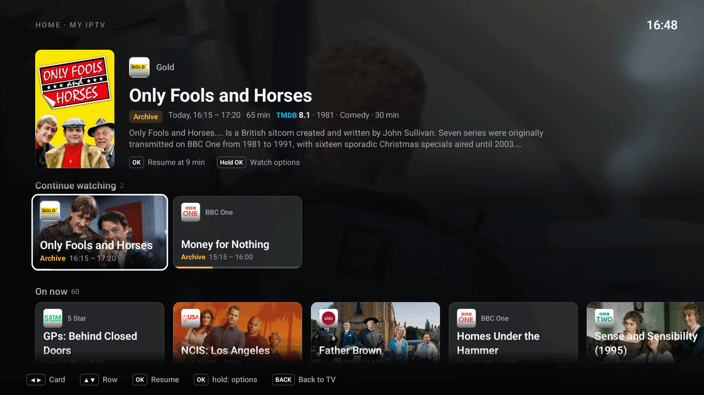</a><br>Home over the playing video: continue watching, on now</td>
    <td width="50%"><a href="screenshots/home-just-started.png">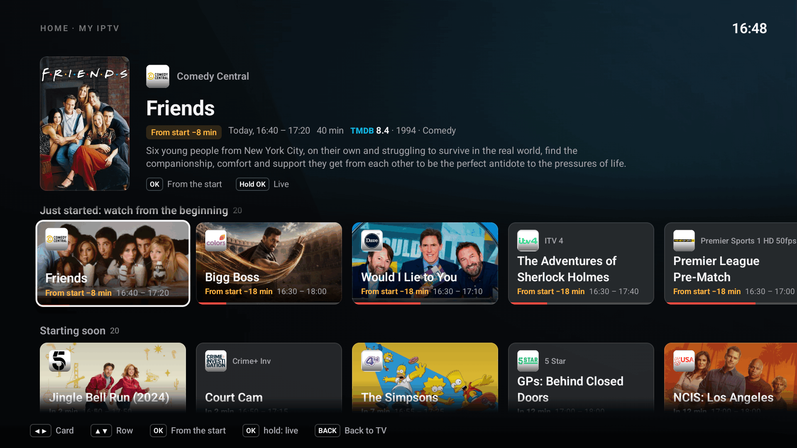</a><br>Just started: OK plays it from the beginning</td>
  </tr>
  <tr>
    <td><a href="screenshots/home-movies.png">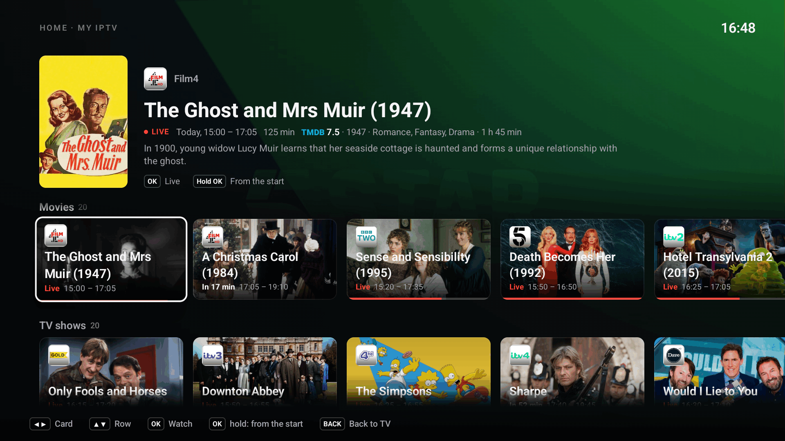</a><br>Movies and TV shows on your channels, with TMDB posters and ratings</td>
    <td><a href="screenshots/home-sources.png">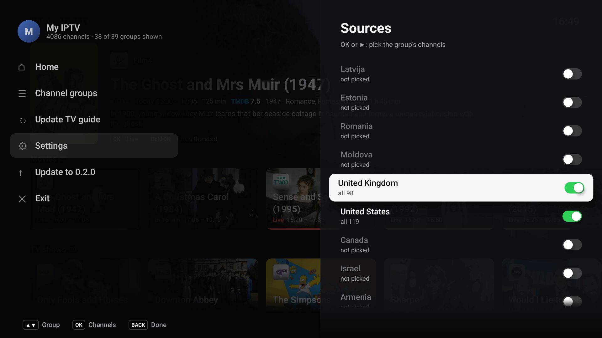</a><br>Home sources: the groups Home takes its programmes from</td>
  </tr>
  <tr>
    <td><a href="screenshots/home-source-channels.png">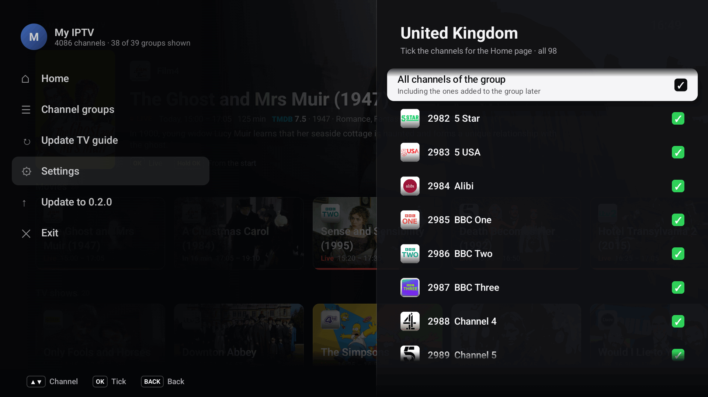</a><br>Or single channels of a group</td>
    <td><a href="screenshots/android-tv-home.png">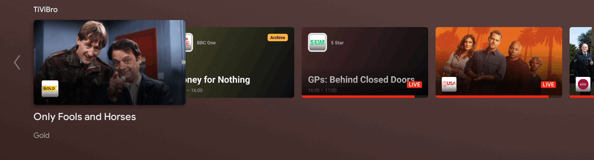</a><br>The TiViBro channel on the Android TV home screen</td>
  </tr>
  <tr>
    <td><a href="screenshots/channel-list.png">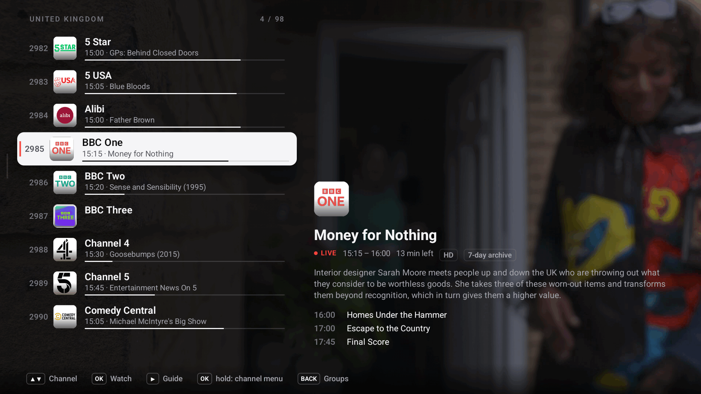</a><br>Channel list of a group, with what is on now and next</td>
    <td><a href="screenshots/programme-view.png">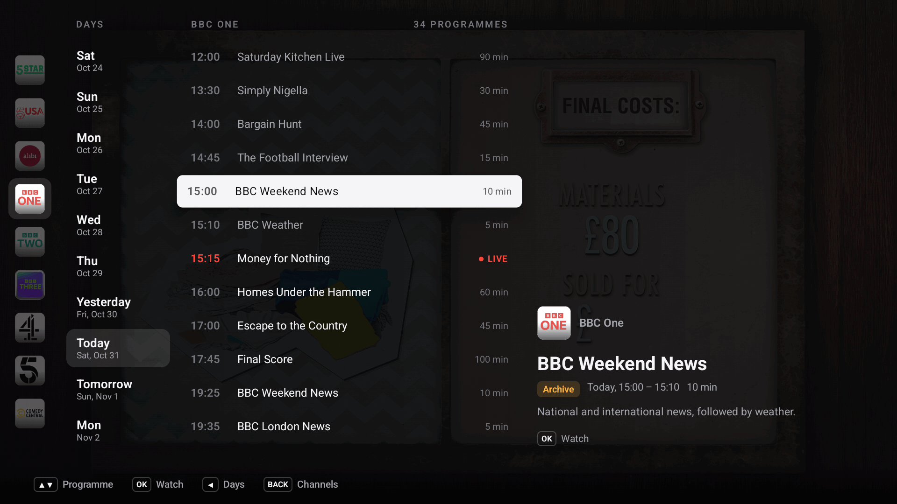</a><br>Programme view: days, programmes and an archive programme ready to watch</td>
  </tr>
  <tr>
    <td><a href="screenshots/player.png">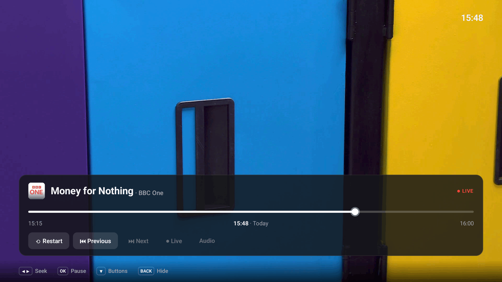</a><br>Player panel: timeline, restart, previous and next programme, back to live</td>
    <td><a href="screenshots/main-menu.png">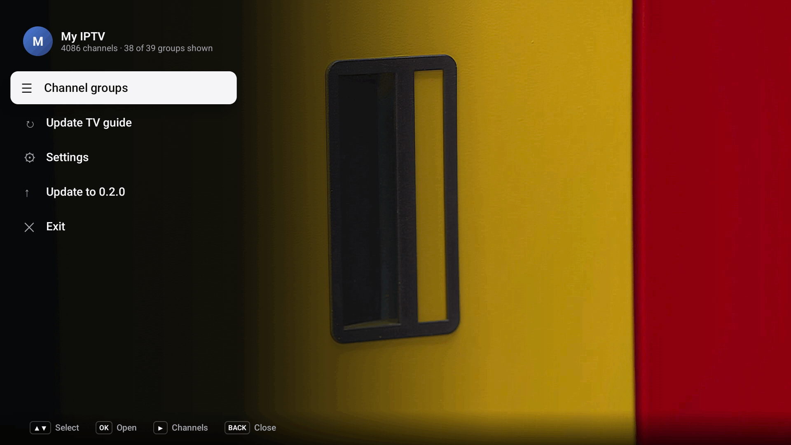</a><br>Main menu, with Home first</td>
  </tr>
  <tr>
    <td><a href="screenshots/settings.png">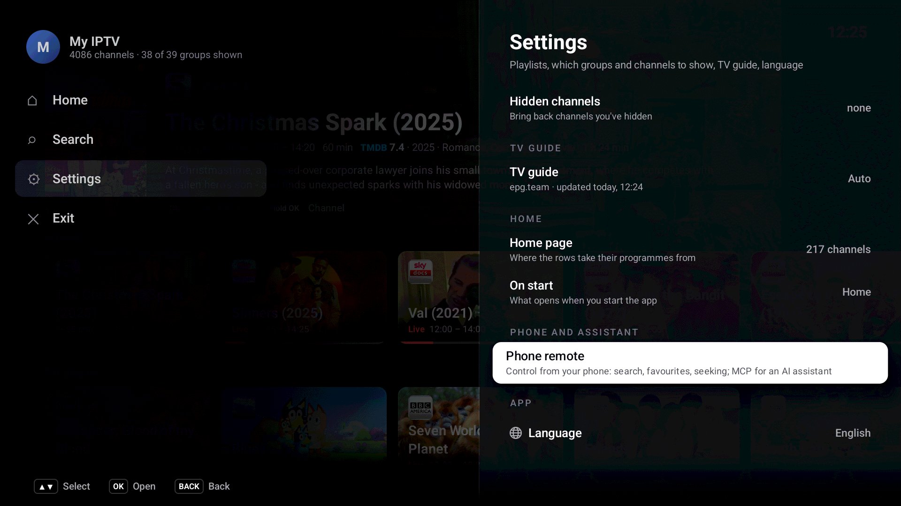</a><br>Settings, with interface size and language</td>
    <td><a href="screenshots/language.png">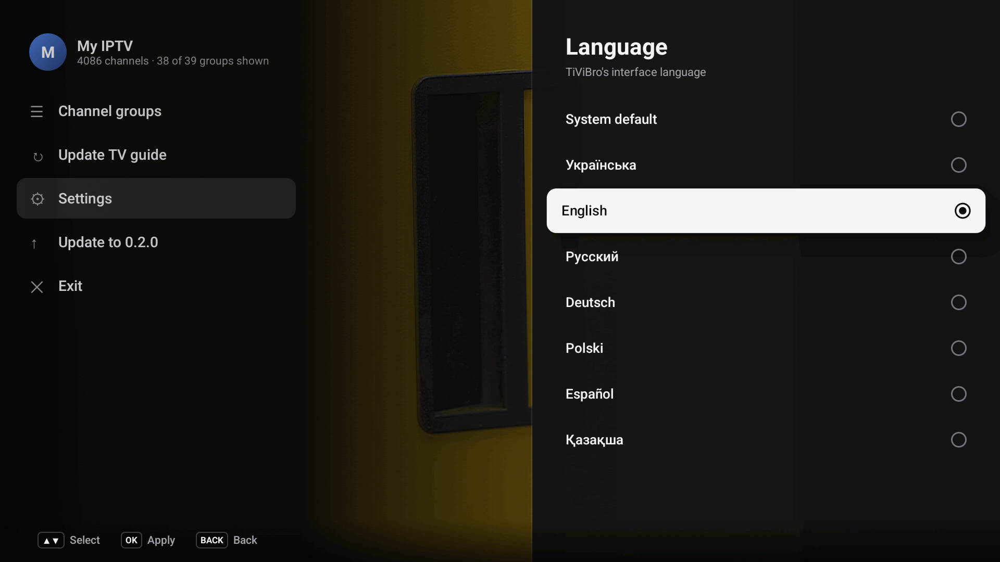</a><br>Language picker: each language in its own name</td>
  </tr>
</table>

## Installing with adb

TiViBro needs Android 6.0 or newer (minSdk 23). Besides opening the APK with a file manager on the TV, you can
install it from a computer: enable developer options and network debugging on the TV, then

```sh
adb connect <tv-ip>:5555
adb install TiViBro-vX.Y.Z.apk
```

## First run and the QR page

TiViBro shows a QR code. Scan it with a phone on the same Wi-Fi network, paste your M3U playlist link into the page
that opens, and tap Send. The TV downloads the playlist and starts the first channel.

The page is served by the app itself on the local network (port 8765, the same server as the
[phone remote](#phone-remote-and-mcp)). It lives at a random address that changes every time it is shown, so only
someone who can see the TV screen can use it, and it answers only while a QR code is on screen.

## Playlists and catch-up

TiViBro reads M3U / M3U8 playlists the way IPTV providers actually write them:

- `#EXTINF` with or without a space before the attributes, durations of `0` or `-1`;
- groups from `group-title` or `#EXTGRP`; entries without a group go to "Other";
- archive depth from `catchup-days`, `timeshift` or `tvg-rec` on the channel, or from `catchup-days` /
  `catchup-time` in the `#EXTM3U` header;
- guide ids from `tvg-id` (including `tvg_NNN` style ids), the `/chNNN/` part of the stream URL, `tvg-name`, or the
  channel name;
- `url-tvg` / `x-tvg-url` in the header as the playlist's guide.

Catch-up URLs are built from `catchup-type` (per channel or in the header), or guessed from the stream URL:

| Scheme | How it is chosen | Archive URL |
| --- | --- | --- |
| Flussonic (HLS and MPEG-TS) | `catchup-type="flussonic"` (also `flussonic-hls`, `flussonic-ts`, `fs`), or a URL ending in `mono.m3u8`, `index.m3u8`, `video.m3u8` and similar | `.../mono-<start>-<duration>.m3u8`, `.../timeshift_abs-<start>.ts` |
| Shift | `catchup-type="shift"` or `timeshift`, or the default for a channel with an archive | `<live url>?utc=<start>&lutc=<now>` |
| Xtream Codes | `catchup-type="xc"`, or a `/live/<user>/<pass>/<id>` URL | `/timeshift/<user>/<pass>/<minutes>/<Y-m-d:H-M>/<id>.ts` |
| Template | any `catchup-source`, with `catchup-type` `default` or `append` | the template with `{utc}`, `{start}`, `{end}`, `{utcend}`, `{lutc}`, `{now}`, `{duration}`, `{duration:60}`, `{offset}`, `{Y}` `{m}` `{d}` `{H}` `{M}` `{S}`, `{(b)...}` and `{(e)...}` filled in |

The token in the live URL's query string is kept on every built-in scheme. When the server answers an archive request
with its "no archive" stub, TiViBro says so and goes back to live instead of playing the stub.

## TV guide

Each playlist picks its guide in Settings > TV guide:

- **Auto** (default): the playlist's own XMLTV link if it has one, otherwise the segmented guide from
  [epg.team](https://epg.team), which arrives day by day, today first.
- **From playlist:** the XMLTV file named by `url-tvg` / `x-tvg-url`.
- **Custom link:** any XMLTV file (`.xml` or `.xml.gz`), sent from your phone through the QR page.

XMLTV files are imported again every 12 hours; the segmented guide is checked every 3 hours and just after midnight.
Downloads are throttled and pause while you use the remote or while the stream is buffering.

## Home

Home is a layer over the video, which keeps playing behind it. Open it with BACK from playback, or from the main menu
("Home", the first item). BACK or OK on Now watching closes it back to the playback. Its rows, top to bottom (a row
with nothing in it is left out):

- **Now watching**: the channel playing, its programme and how far along it is (for an archive programme, where the
  playback is in it). Focus starts here; OK goes back to the playback as it is, without re-tuning. Shown only while
  something plays, and only in the app, never on the Android TV home screen.
- **Continue watching**: archive programmes you stopped in, on any channel of the playlist, newest first, while they are
  still in the archive.
- **On now**: what is on the Home sources now.
- **Just started: watch from the beginning**: programmes that started in the last 20 minutes on channels with an
  archive, at least 20 minutes long. Ads, teleshopping, breaks and test cards are left out, and the same title shows
  once.
- **Starting soon**: what starts in the next 30 minutes.
- **Movies** and **TV shows**: programmes on now or later today that TMDB recognises, with poster, rating, year and
  genres; what is on now or within the hour first, then by rating.

**Sources.** Home reads the guide only of the channels you pick: Settings > Home page > Sources lists the playlist's
groups with how much of each is picked ("all 98", "5 of 87"). OK or ▶ on a group opens its channels, with tick boxes
and "All channels of the group" (which also takes channels the provider adds to the group later). Sources are kept per
playlist. Until you pick some, Home shows only Continue watching and a "Choose sources" button. Home reads at most 300
source channels, in the background, a chunk at a time; rows fill in while Home is open.

**Cards.** The focused card is the lit one, and its details are above the rows: the full title, channel, time, TMDB
rating, year and genres, a short description, and what OK does. OK plays a live programme live, a past one from the
archive (resuming where you stopped), and «Just started» from the beginning; on a programme still to come it says when
it starts. Hold OK for the watch options of a bookmark, to start a live programme from the beginning, or the channel
menu.

**On start.** Settings > On start chooses between the last channel (the default) and Home. A playlist that has no last
channel yet (its first start) opens on Home.

**TMDB.** Movies, TV shows and pictures need a TMDB key. Release builds come with one; otherwise, or to use your own,
Settings > Home page > Your own TMDB key takes an API Read Access Token from
[themoviedb.org](https://www.themoviedb.org/settings/api), typed on your phone through the QR page ("-" goes back to
the built-in key). "Posters and descriptions from TMDB" turns it all off. Matching is strict: a programme gets a
picture only when its title, kind (film or series, from «х/ф», «т/с», episode numbers) and year agree with TMDB, since
a wrong poster is worse than none.

### On the Android TV home screen

On Android 8 and newer, TiViBro adds a «TiViBro» channel to the launcher with up to 12 programmes: what to continue
first, then what is on now on the Home sources. Unfinished archive programmes also go to Play Next (Watch Next) with
their progress; finished ones and those that left the archive are removed. Opening one starts it in TiViBro: a live
programme live, an archive programme where you stopped (or live, with a note, when it has left the archive). The row is
updated when your bookmarks change, when you leave the app and every 45 minutes, from what the app saved; only
titles, times and pictures are shared with the launcher, never stream links.

The links it uses can also be opened by other apps: `tivibro://home`, `tivibro://live/{playlist}/{channel}` and
`tivibro://archive/{playlist}/{channel}/{start ms}?position={ms}`.

## Remote control

BACK always leads back to playback. From playback it opens Home, and BACK on Home closes it again. In the channel list
and the programme view BACK closes the whole list in one press, wherever the focus is; ◀ walks deeper (programmes >
days, channels > groups > main menu). The main menu goes back with BACK to where it was opened from: Home if it was
opened from Home, otherwise playback. The main menu holds Home, Search, Settings and Exit; channel groups, refreshing
the TV guide and installing an update are in Settings (Channel groups, TV guide > Refresh, Update to X.Y.Z).

Settings sheets go back one sheet at a time, dialogs close back to where they were opened from, and BACK on the player
panel only hides the panel. "Exit" in the main menu closes the app.

### Home

| Key | Action |
| --- | --- |
| ◀ ▶ | Previous / next card (◀ on the first card opens the main menu) |
| ▲ ▼ | Previous / next row; each row remembers its card. CH+ / CH- jump to the first / last row |
| OK | Now watching: back to the playback. Otherwise watch, resume, or from the beginning (Just started); a programme still to come says when it starts |
| Hold OK | Watch options of a bookmark; from the beginning of a live programme; channel menu of Now watching and of one to come |
| RED | Favourite |
| MENU | Main menu |
| BACK | Back to playback |

### Plain playback

| Key | Action |
| --- | --- |
| ▲ / CH+, ▼ / CH- | Next / previous channel |
| ◀ | Channel list |
| ▶, GREEN | Programme view of the current channel, on the programme being played |
| BACK | Home |
| OK | Player panel |
| Hold OK | Channel menu (favourite, hide) |
| 0-9 | Channel by number |
| PLAY/PAUSE | Pause (live TV is paused into the archive) |
| RED | Add to or remove from favourites |
| YELLOW / LAST CHANNEL | Recent channels, on the one you watched before |
| INFO | Show or hide the channel banner |
| MENU | Main menu |
| SEARCH | Search (from anywhere) |

### Player panel

| Key | Action |
| --- | --- |
| ◀ ▶ | Seek back / forward, faster while held |
| OK | Pause / play |
| ▼ | Buttons: Restart, Previous, Next, Live, Audio |
| ▲ | Back to the timeline from the buttons |
| CH+ / CH- | Switch channel |
| BACK | Hide the panel |

### Channel list

| Key | Action |
| --- | --- |
| ▲ ▼ | Move; CH+ / CH- page by 9 |
| OK | Watch (on a Continue watching item: resume) |
| Hold OK | Channel menu; on a Continue watching item: From the start, Remove from Continue watching, Mark as watched |
| ▶ | Programme view of the channel |
| RED | Favourite |
| ◀ | Groups |
| BACK | Back to playback |

In the groups rail, ▲ ▼ choose a group, ▶ or OK go back to the channels, ◀ opens the main menu and BACK goes back to
playback.

### Programme view

| Key | Action |
| --- | --- |
| ▲ ▼ | Previous / next programme |
| CH+ / CH-, YELLOW / BLUE | Same time on the previous / next day |
| ◀ | Days column (▲ ▼ day, ▶ or OK back to the programmes) |
| OK | Watch: live for the programme on air, the archive for past ones, resume where you stopped |
| Hold OK | On air: from the start. Watched archive programme: watch options |
| BACK | Back to playback |

## Search

Main menu > Search (second, under Home) or the remote's SEARCH key opens a text field over the video, with the system
keyboard (on Android TV, Gboard or the Leanback keyboard, both with a mic for voice input). Results update as you
type: up to 12 channels and 40 programmes, the same search as the phone page (see the search index below). With an
empty field it lists your last 8 searches (those that led to something being played).

| Key | Action |
| --- | --- |
| OK (on the field) | Bring up the keyboard |
| ▼ (on the field) | To the results (with the keyboard up, its own Search key or BACK hides it first) |
| ▲ ▼ | Move; ▲ on the first result goes back to the field. CH+ / CH- page by 8 |
| OK | Channel: watch live. Programme on now: watch live. Archive: watch (resumes a bookmark). Upcoming: when it starts. Recent search: search it again |
| Hold OK | Programme on now: from the start. Half-watched archive programme: watch options. Channel: channel menu |
| RED | Favourite (on a channel) |
| BACK | Back to where Search was opened from (Home or playback) |

The field takes Compose focus only while it is lit (and is not focusable otherwise): with focus cleared, Compose hands
it back to the first focusable it finds, and a text field that gets it brings the keyboard back up over the results.
Every other key is routed by the view model as on other screens; while the field is lit, keys it does not use (letters,
digits, ◀ ▶, delete) go through to it, so digits type instead of switching channels.

## Phone remote and MCP

While the app process runs, TiViBro serves one small HTTP server on the local network, port 8765 (another free port if
that one is taken). It carries the QR setup page, the phone remote and an MCP endpoint, and is advertised over
mDNS/DNS-SD as `_tivibro._tcp` (`dns-sd -B _tivibro._tcp` on a Mac lists it).

Everything except the setup page needs the token shown in Settings > Phone remote. It is random, kept across
restarts, and replaced by «New link». It can be given three ways: as the first path segment
(`http://<tv-ip>:8765/<token>/…`, what the QR code and the MCP address use), as `Authorization: Bearer <token>`, or as
`?t=<token>`. Without it the server answers 404 (401 on `/api` and `/mcp`).

**Phone page** (`/<token>`), three tabs. Home: Continue watching as the TV's Home shows it (tap resumes on the TV
where it stopped, also for a programme still on air; × removes the bookmark), the 10 channels watched last, and now and
next on the favourites. Search: a search box with live results, channels and programmes. Channels: the favourites
(«Reorder» moves them up and down a step at a time), then the playlist's groups (switched-off groups and hidden
channels left out, as in the app); a group lists its channels 40 at a time as you scroll, each with what is on now; at
the end, «Hidden groups and channels» mirrors Settings > Channel groups (a switch per group) and Hidden channels
(«Show channel»). Every channel row has a ☆ that toggles the favourite at once (optimistically, put back if the TV
refuses); holding a channel opens its menu (live, schedule, favourite, hide), holding a group offers to hide it. A
channel's › opens its schedule: one day at a time, from as far back as its archive goes (at most 14 days) to tomorrow.
Tapping a programme opens its details (title, time, channel, the guide's description, read on demand) with what can be
done: watch or resume an archive programme, from the start, live; one still to come only says when it starts. Where
you are is kept in the address's `#` part (`#search`, `#groups`, `#g/<group>`, `#s/<channel>/<day>`, `#hidden`), so
the phone's back button and a reload work. Changes go through the same view model functions as the TV's own keys, so
they are saved and shown on the TV (with its toast) exactly as if made with the remote.

The strip at the bottom shows what the TV plays, with channel down, play / pause and channel up; tapping it opens the
player panel: the programme with its description, a live / archive / paused badge and how far behind live it is, a
seek bar over the programme (drag or tap; it is clamped to what the archive holds and to now, and past the live edge
it returns to live), −5 min, −30 s, play / pause, +30 s, +5 min, previous / next programme (as the TV's player panel),
from the start, back to live, channel down / up, and the audio tracks when there are several. Every action answers
with the player's new state; otherwise the page polls `/api/now` every 2 s with the panel open and every 8 s without,
and not while the page is hidden. The TV's clock comes with each answer (`serverNow`), so a phone whose clock is off
still draws the live edge right. When TiViBro is not in front on the TV (`foreground: false`) a banner says so and
taps that would play or steer playback are refused with it; favourites, hiding and bookmarks still work.

«Add to Home screen» uses `/<token>/manifest.webmanifest` (standalone, the token in `start_url`) and
`/<token>/icon.png` (192 px, from `assets/remote`). Chrome treats a plain-http LAN page as insecure, so on Android it
may add a shortcut that opens in a browser tab rather than a standalone window; Safari on iOS opens it full-screen.

**JSON API** (all under the token): `GET /api/search?q=` (channels and programmes), `GET /api/channels?q=&limit=`,
`GET /api/programmes?q=&limit=`, `GET /api/whatson?channel=` (no channel: favourites), `GET /api/now`,
`GET /api/groups` (`{"groups": [{"id", "name", "count"}]}`, favourites first with id `*fav`),
`GET /api/group?id=&offset=&limit=` (a page of a group's channels with what is on now, and `total`; limit 40 by
default, 100 at most), `GET /api/schedule?channel=&day=` (`day` 0 is today, -1 yesterday, 1 tomorrow; answers the
channel, its `days` as `{"day", "start"}` local midnights, and the day's `programmes` with `when` now / archive /
upcoming), `GET /api/home` (`bookmarks`, `recent`, `favourites`, `foreground`), `GET /api/hidden` (every provider
group with `shown`, and the hidden channels), `GET /api/programme?channel=&start=` (one programme with `desc`,
`resumeAt` and `inArchive`; `pending` while the guide still reads the description: ask again shortly). Every channel
object carries `fav`.

`GET /api/now` answers `playing`, `foreground`, `serverNow`, the `channel`, `mode` (live / archive), `paused`,
`position` (the frame on screen, epoch ms), the `programme` (with `desc` once read), `canSeek`, `earliest` (the oldest
moment the archive holds), `can` (which of restart, previous_programme, next_programme, live make sense now) and
`audio` (`[{"index", "name", "selected"}]`).

POST, with a JSON body:

- `/api/play` `{"channelId", "start": <ms>, "fromStart": true, "resume": true}` (`start` only for a programme;
  `resume` continues a bookmark even of a programme still on air, which otherwise plays live);
- `/api/key` `{"key": "pause" | "resume" | "playpause" | "next" | "prev" | "live" | "restart" | "previous_programme" |
  "next_programme"}`, answered with `now`;
- `/api/seek` `{"by": <ms>}` (negative goes back) or `{"to": <epoch ms> | "HH:MM"}` (the most recent such time),
  answered with `now`; from live it goes back into the archive, past the live edge it returns to live;
- `/api/audio` `{"index": n}` (0-based), answered with the `tracks`;
- `/api/fav` `{"channelId", "on": true | false}`, answered with the new `favs` list; `/api/fav/move`
  `{"channelId", "dir": -1 | 1}` (one step past the next favourite the user can see);
- `/api/hide` `{"channelId", "hidden": true | false}`; `/api/group/show` `{"group", "shown": true | false}`;
- `/api/bookmark/forget` `{"channelId", "start"}`.

Playback control (`key`, `seek`, choosing an audio track) needs TiViBro on screen; the rest works while it is in the
background as long as its process lives.

**MCP** (`POST /<token>/mcp`, or `/mcp` with the Bearer header): Streamable HTTP, stateless, plain JSON responses, no
SSE and no sessions. Legacy clients (protocol 2024-11-05 to 2025-11-25) start with `initialize`; 2026-07-28 clients
send the version in each request's `_meta` and may call `server/discover`. Tools: `search_channels`,
`search_programmes`, `whats_on`, `play_channel`, `play_programme`, `now_playing`, `control` (pause, resume, channel
up / down, back to live, restart, previous / next programme), `seek` (`seconds`, negative back, or `to` a time of day
like "21:30" or epoch ms), `audio_track` (lists the tracks, or switches to `track`, numbered from 1),
`list_favourites`, `add_favourite`, `remove_favourite`, `continue_watching`, `resume` (a bookmark by `channel_id` and
`start`, or the most recent one), `list_groups` and `list_channels` (a group's channels, paged). Results carry channel
ids and programme start times (epoch ms) to pass back to the play tools, plus the TV's local time for the assistant to
say.

```sh
# Claude Code
claude mcp add --transport http tivibro http://<tv-ip>:8765/<token>/mcp
# or with the header form
claude mcp add --transport http tivibro http://<tv-ip>:8765/mcp --header "Authorization: Bearer <token>"
# clients that only start local (stdio) servers
npx mcp-remote http://<tv-ip>:8765/<token>/mcp
```

The TV's address can change when the router hands out a new one; give the TV a fixed address (a DHCP reservation in
the router) if an assistant or a bookmark should keep working.

**Connections and Chrome.** The server reads one request per connection and closes it (`Connection: close`). A
connection may sit idle for up to 15 minutes before its request: Chrome opens spare connections ahead of time (the
omnibox does while an address is typed) and Chrome for Android was seen keeping an unused one for 277 s. At most 64
connections are open at once; at the cap the oldest one still waiting for its request is closed to make room. A TLS ClientHello (https:// typed, or Chrome's
HTTPS upgrade with «Always use secure connections» on for private sites) gets a TLS alert at once, so Chrome falls back
or shows its «not secure» page without waiting. Every connection ends in one line under the logcat tag
`tivibro-http`, with the token masked:

```
10.10.0.42:51234 GET /3f9a…/api/now HTTP/1.1 -> 200 648 B; closed by the client (31 ms)
10.10.0.42:51240 TLS ClientHello, refused with a TLS alert; closed by the client (4 ms)
10.10.0.42:51236 idle, closed by the client without a request (10012 ms)
```

Chrome's `ERR_TOO_MANY_RETRIES` on a plain HTTP page means it retried the request 50 times on connections it took
for reusable that then ended without a response. If a phone's Chrome shows it while other browsers work, check these
lines while it loads: no lines at all from the phone's address mean the requests never reach the TV (a VPN, a proxy
in the Wi-Fi settings, which Chrome uses and some browsers ignore); lines ending without a request mean the
connections arrive and are dropped on the way back.

**Starting playback when TiViBro is not on screen.** When the app is in the foreground, a play request switches
playback at once and closes whatever was open (menu, list, Home). When it is in the background, TiViBro tries to bring
itself to the front with the same link the Android TV home screen uses. Android 10 and newer block that for apps in
the background (the log says «Background activity start … isBgStartWhitelisted: false»); the request then fails with
a message asking to open TiViBro on the TV. The «display over other apps» permission would lift the limit, but
TiViBro does not ask for it. Search works either way while the app's process is alive.

**Search index.** Programme search runs over an index of every channel's guide: the archive each channel actually has,
what is on, and what is coming. It is built on a background thread from the guide files (about 16 s for 4000
channels and 800 000 programmes on a 2020 Realtek TV), saved, and loaded on the next start (about 2 s). It takes about
20 MB of memory: titles are stored once, searched as one byte per character, and the display titles stay on disk.
Search is case-insensitive and ignores accents, apostrophes and the й/и, ё/е, ї/і, ґ/г difference; every word of the
query must match the start of a word in the title (or, ranked last, the inside of one). Results come in this order:
on now, the archive (most recent first), upcoming (soonest first). Hidden channels and groups are left out.

## Building from source

Requirements: JDK 17 and the Android SDK (API 35). Point `local.properties` at the SDK (`sdk.dir=...`) or set
`ANDROID_HOME`.

```sh
./gradlew assembleDebug        # app/build/outputs/apk/debug/app-debug.apk
./gradlew testDebugUnitTest    # unit tests
./gradlew assembleRelease      # minified release build
```

The TMDB key built into the APK (see [Home](#home)) is read from the Gradle property `tmdbToken`, else the
`TIVIBRO_TMDB_TOKEN` environment variable, else the file `~/.config/tivibro/tmdb_token`; without any of them the build
has no key and users can add their own. It is a TMDB API Read Access Token (v4). Keep it out of the repository.

A debug build accepts a playlist from adb, which is handy on an emulator:

```sh
adb shell am start -n dev.romirom.tivibro/.MainActivity --es playlist 'https://example.com/playlist.m3u'
```

### Versions and signing

`versionName` and `versionCode` come from the release tag: `vX.Y.Z` gives version name `X.Y.Z` and version code
`X*10000 + Y*100 + Z` (v1.4.2 is 10402). Pass it as `-PtivibroVersion=X.Y.Z` or the `TIVIBRO_VERSION` environment
variable; without it a local build is version `0.1` (code 1).

The release build is signed with the first of these that exists:

1. `~/.config/tivibro/keystore.properties` with `storeFile`, `storePassword`, `keyAlias` and `keyPassword`;
2. the environment variables `TIVIBRO_KEYSTORE_BASE64`, `TIVIBRO_KEYSTORE_PASSWORD`, `TIVIBRO_KEY_ALIAS` and
   `TIVIBRO_KEY_PASSWORD` (used by CI);
3. the debug key, so that anyone can build a release APK without the real one.

Never commit the keystore or its passwords; `.gitignore` already keeps `*.jks`, `*.keystore` and
`keystore.properties` out.

## Releasing

### One-time setup

Add the repository secrets under Settings > Secrets and variables > Actions on GitHub, taken from
`~/.config/tivibro/` on the machine that holds the release key:

| Secret | Value |
| --- | --- |
| `TIVIBRO_KEYSTORE_BASE64` | the contents of `release.jks.base64` |
| `TIVIBRO_KEYSTORE_PASSWORD` | `storePassword` from `keystore.properties` |
| `TIVIBRO_KEY_ALIAS` | `keyAlias` from `keystore.properties` |
| `TIVIBRO_KEY_PASSWORD` | `keyPassword` from `keystore.properties` |
| `TIVIBRO_TMDB_TOKEN` | optional: the TMDB API Read Access Token built into releases |

With the GitHub CLI, from the repository directory:

```sh
cd ~/.config/tivibro
gh secret set TIVIBRO_KEYSTORE_BASE64 -R romirom11/TiViBro < release.jks.base64
gh secret set TIVIBRO_KEYSTORE_PASSWORD -R romirom11/TiViBro --body "$(sed -n 's/^storePassword=//p' keystore.properties)"
gh secret set TIVIBRO_KEY_ALIAS -R romirom11/TiViBro --body "$(sed -n 's/^keyAlias=//p' keystore.properties)"
gh secret set TIVIBRO_KEY_PASSWORD -R romirom11/TiViBro --body "$(sed -n 's/^keyPassword=//p' keystore.properties)"
gh secret set TIVIBRO_TMDB_TOKEN -R romirom11/TiViBro < tmdb_token
```

Keep a backup of `~/.config/tivibro/` somewhere safe. Android only accepts an update signed with the same key, so if
the key is lost, every user has to uninstall and install again.

### Publishing a release

```sh
git tag v1.2.3
git push origin v1.2.3
```

The `Release` workflow (`.github/workflows/release.yml`) then:

1. checks that the tag is `vX.Y.Z` and that the signing secrets are present;
2. runs the unit tests and builds the signed release APK with version `X.Y.Z`;
3. publishes a GitHub Release for the tag with `TiViBro-vX.Y.Z.apk` attached and release notes generated from the
   commits since the previous release.

Building and publishing are separate jobs: the build job sees the signing secrets but can only read the repository,
and the publish job can create releases but never sees the secrets. Every action is pinned to a commit SHA, and
Dependabot (`.github/dependabot.yml`) proposes updates to those pins weekly.

Installed copies find the new release on their next check (see below) and offer to update. The `CI` workflow builds
and tests every other push and every pull request.

## Auto-update

On start, and at most once every 12 hours, TiViBro asks the GitHub API for the latest release of
`romirom11/TiViBro` (no account or token involved). If its tag is newer than the installed version and it has an APK
attached:

- a short message says "Update available: X.Y.Z";
- the main menu's Settings item shows "↑ X.Y.Z", and Settings opens on the update row;
- Settings > Check for updates checks right away; with an update waiting the row reads "Update to X.Y.Z" and installs
  it.

Choosing the update downloads the APK to the app's cache, showing progress, and hands it to Android's package
installer, which asks you to confirm. On Android 8 and newer, the first time, Android has to allow TiViBro to install
apps: TiViBro opens that settings screen for you; switch it on, go back and choose the update again.

If the API call fails (anonymous API calls are limited to 60 an hour per IP address, shared by every device at
home), TiViBro falls back to `https://github.com/romirom11/TiViBro/releases/latest`, which redirects to the newest tag
and has no such limit; the APK is then expected at `releases/download/<tag>/TiViBro-<tag>.apk`, the name CI gives it.

Being offline, hitting a rate limit or a repository without releases are not errors: an automatic check stays
quiet, and a manual check just says it couldn't check. The debug `updateUrl` override below skips the web fallback.

For testing, a debug build can read a local JSON shaped like GitHub's `releases/latest` response:

```sh
adb shell am start -n dev.romirom.tivibro/.MainActivity --es updateUrl 'http://10.0.2.2:8000/latest.json'
adb shell am start -n dev.romirom.tivibro/.MainActivity --es updateUrl ''   # back to GitHub
```

## Privacy

- Your playlist links, guide links, favourites and bookmarks stay on the device. Nothing is uploaded anywhere.
- No analytics, no crash reporting, no accounts.
- The app talks only to your provider (playlist and streams), to the guide source you chose (the playlist's XMLTV
  link, a custom link, or epg.team in Auto mode), to GitHub to check for and download updates (the GitHub API, or the
  github.com releases page when the API is rate-limited) and, when «Posters and descriptions from TMDB» is on, to TMDB.
- With TMDB on, the titles of programmes shown on Home (only those, never your whole playlist) are sent to
  [TMDB](https://www.themoviedb.org) to find posters, ratings and descriptions, and the pictures are loaded from
  TMDB's image server. Nothing else is sent: no playlist or stream links, no account. Answers are cached on the device
  for a week. Turn it off in Settings > Home page.
- The Android TV home screen row and Play Next get only titles, times and pictures, never stream links.
- The QR setup page is served on your local network only, under a random address, and only while it is on screen.
- The phone remote and the MCP endpoint are served on your local network only, behind a random token that you can
  replace at any time (Settings > Phone remote > New link). They see channel names and the TV guide, never stream or
  playlist links.

## License and third-party code

TiViBro is free software under the [GNU General Public License v3.0](../LICENSE).

The GPL is required because the app bundles the FFmpeg audio decoder from
[jellyfin-androidx-media](https://github.com/jellyfin/jellyfin-androidx-media), which is GPL-3.0. Other libraries
(AndroidX Media3, Jetpack Compose, AndroidX TV Provider and WorkManager, OkHttp, Coil, ZXing) are under the Apache
License 2.0.

Posters, ratings and descriptions come from [TMDB](https://www.themoviedb.org). This product uses the TMDB API but is
not endorsed or certified by TMDB.
